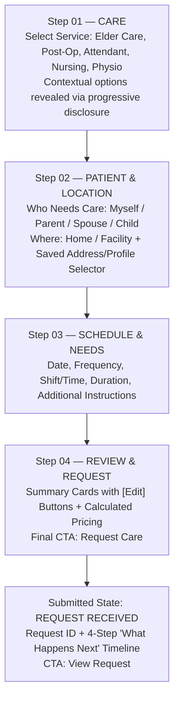
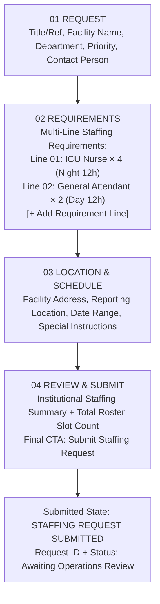
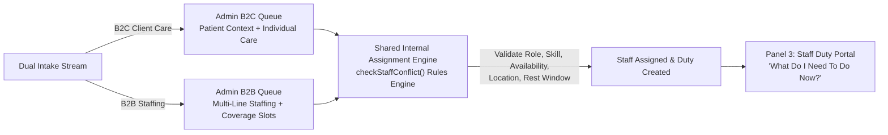
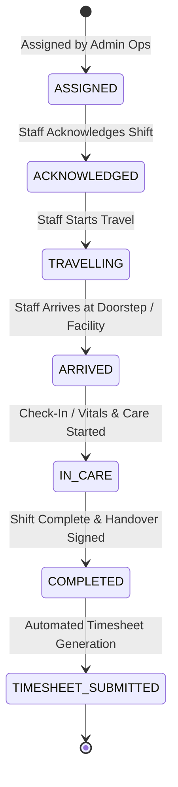

# Pulse n Care — Complete B2C + B2B Intake & Operations Flow (V6 Architecture)

This document defines the formal product flow, progressive disclosure models, role-appropriate information visibility, and lifecycle state machines for both Individual/Family Clients (B2C) and Institutional Organizations (B2B).

---

## 1. Actor & Panel Mapping

| Product Panel | Target User / Actor | Key Entry Point | Product Scope & Visibility |
| :--- | :--- | :--- | :--- |
| **Panel 1 (B2C Client)** | Individual / Family | CTA: `I Need Care` (`/client/booking/wizard`) | 4-step progressive intake (`CARE → PATIENT & LOCATION → SCHEDULE & NEEDS → REVIEW & REQUEST`). Sees own care requests, patient profiles, bookings, and invoices. |
| **Panel 1 (B2B Workspace)** | Organization / Facility | CTA: `For Organizations` (`/organization/requests/new`) | Institutional staffing intake (`01 REQUEST → 02 REQUIREMENTS → 03 LOCATION & SCHEDULE → 04 REVIEW & SUBMIT`). Multi-line requirements in one request. Sees own staffing requests, roster, timesheets, and invoices. |
| **Panel 2 (Admin Command Center)** | Operations Team / Super Admin | `/admin/dashboard` | Internal operations control: distinguishes B2C Care Requests vs. B2B Staffing Requests. Rule-based eligibility matching, duty assignment, timesheet approval, and billing reconciliation. |
| **Panel 3 (Staff Duty Portal)** | Internal Employee / Nurse | `/staff/dashboard` | Mobile-first operational portal: *"WHAT DO I NEED TO DO NOW?"*. Manages shift state machine (`Assigned → Travelling → Arrived → In Care → Completed`). |

---

## 2. B2C Individual Client Intake Flow (4-Step Progressive Disclosure)

### Detailed B2C Intake Breakdown
1. **Step 01 — CARE**:
   - Question: *"What kind of care do you need?"*
   - Supported Options: Elder Care, Recovery / Post-Hospital Care, Patient Attendant, Nursing Care, Physiotherapy, Doctor Visit, Home ICU.
   - Progressive Disclosure: Selecting a service dynamically displays only relevant contextual questions (e.g., Post-Op displays surgical dressing & catheter tasks; Physio displays affected joint & mobility status).
2. **Step 02 — PATIENT & LOCATION**:
   - Patient Section: *"Who needs care?"* (`Myself`, `Parent`, `Spouse`, `Child`, `Someone else`). Name, Age, Gender, and conditional medical notes. Includes `Saved Patient Selector` to prevent duplicate entry.
   - Location Section: *"Where is care required?"* (`Home`, `Facility`). Address, Area, Pincode, Landmark/Access Notes. Includes `Saved Address Selector` with Delhi NCR hub validation.
3. **Step 03 — SCHEDULE & NEEDS**:
   - Grouped scheduling: Start Date, Frequency (`One time`, `Daily`, `Selected days`, `Recurring`), Shift & Time Slot (`12h Day`, `12h Night`, `24h Live-In`), Duration, Special instructions.
4. **Step 04 — REVIEW & REQUEST**:
   - Clean summary cards with `[Edit]` buttons for Care, Patient, Location, Schedule, and Requirements. Transparent price calculation.
   - Final CTA: **`Request Care`** (Avoids misleading "Booking Confirmed" wording before ops assignment).
5. **Submission State — REQUEST RECEIVED**:
   - Generates unique Request ID (`PNC-CARE-2026-XXXX`).
   - Displays 4-step "What Happens Next" timeline:
     - `01 Care team reviews request`
     - `02 Qualified in-house staff assigned`
     - `03 Client receives confirmation & staff credentials`
     - `04 Care begins as scheduled`

---

## 3. B2B Organization Staffing Intake Flow (4 Major Sections)

### Detailed B2B Intake Breakdown
1. **Section 01 — REQUEST**:
   - Captures Request Title/Ref (e.g. *"September ICU & Recovery Coverage"*), Organization/Facility Name, Department (`Cardiac ICU Ward 4`), Contact Person, Phone, Email, and Request Type (`Monthly Retainer`, `Per-Shift`, `Emergency`).
2. **Section 02 — REQUIREMENTS (Multi-Line Staffing Lines)**:
   - Allows adding **multiple requirement lines** within a single request:
     - **Line 01**: Role: `ICU / Cardiac Critical Care Nurse`, Quantity: `4`, Shift: `12h Night`, Qualifications: `B.Sc Nursing, ACLS Certified`, Daily Rate: `₹3,400`.
     - **Line 02**: Role: `Physiotherapy Specialist`, Quantity: `2`, Shift: `8h General`, Qualifications: `BPT/MPT`, Daily Rate: `₹2,800`.
   - Includes `[+ Add Requirement Line]` and `[Remove Line]` controls.
3. **Section 03 — LOCATION & SCHEDULE**:
   - Start Date, End Date, Schedule Type (`Date Range`, `Recurring`), Facility Reporting Office, Supervisor Name, and Scrub/Uniform Requirements.
4. **Section 04 — REVIEW & SUBMIT**:
   - Institutional summary detailing total requested staff count across all requirement lines.
   - Final CTA: **`Submit Staffing Request`** -> Status: `Awaiting Operations Review`.

---

## 4. Admin Operations Workflow & Assignment Model

### Admin Request Differentiation
- **B2C Client Requests**: Displayed under Client Care Requests Queue with Patient Name, Relationship, Clinical Service, Home Address, Schedule, and Individual Booking Code.
- **B2B Staffing Requests**: Displayed under Institutional Staffing Queue with Organization Name, Facility Department, Requested Roster Slot Count (e.g. `6 Staff / 2 Lines`), Coverage Progress (`0/6 Assigned`), and Facility Contact.
- **Unified Rule-Based Assignment Engine**:
  - Validates: `✓ Role Category Match`, `✓ Skill/Certification Match`, `✓ Geographic Proximity`, `✓ Minimum 10-Hour Rest Window`, `✓ Schedule Conflict Prevention`.
  - Factual logic only — zero fake "92% AI match scores".

---

## 5. Staff Employee Duty Portal Lifecycle

---

## 6. Role-Appropriate Information Visibility Matrix

| Data Field / Entity | B2C Client | B2B Organization | Admin Operations | Internal Staff |
| :--- | :--- | :--- | :--- | :--- |
| **Own Requests & Bookings** | Full Access | Full Access | Full Access | Assigned Duties Only |
| **Other Clients' Data** | NO ACCESS | NO ACCESS | Full Access | NO ACCESS |
| **Other Organizations' Data**| NO ACCESS | NO ACCESS (Org A ≠ Org B) | Full Access | NO ACCESS |
| **Patient Medical Notes** | Own Patients | Permitted Unit Notes | Full Access | Duty-Specific Care Context Only |
| **Assigned Nurse Profile** | Name, Photo, Badge | Name, Photo, Credentials | Full Profile | Own Profile Only |
| **Internal Rate / Margin** | Base Price Only | Agreed Shift Rates | Full Cost Breakdown | Base Payout Only |
| **Timesheets & Invoices** | Own Invoices | Own Facility Invoices | Platform Verification | Own Hours Submitted |

---

*Document created for Pulse n Care V6 Architecture.*
