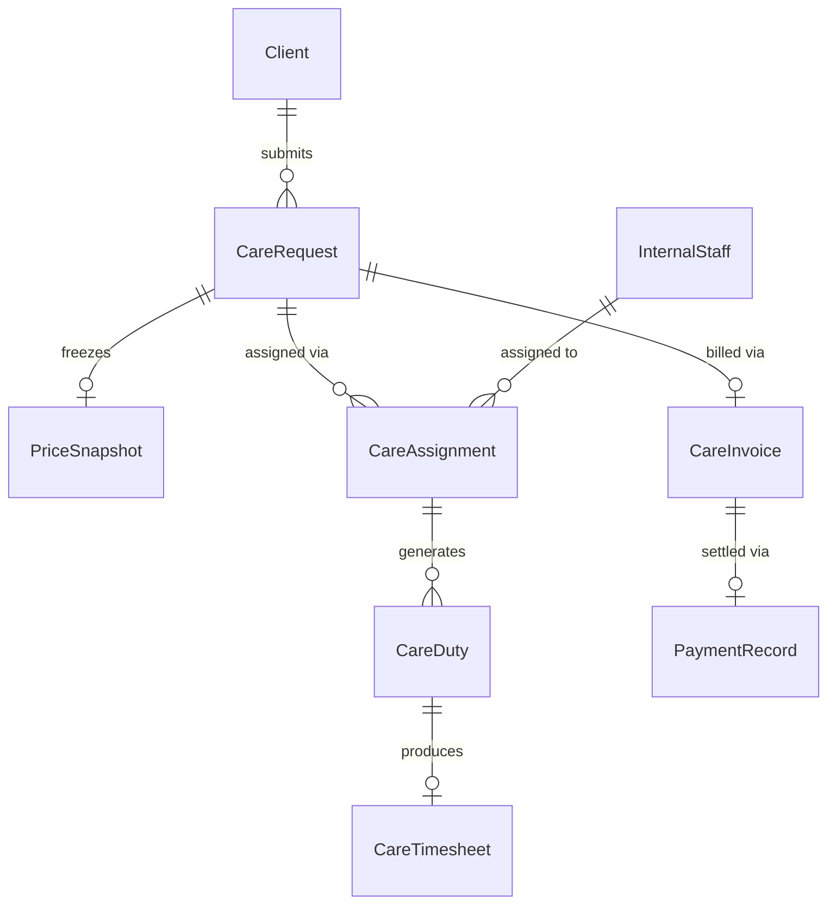

# PULSE N CARE — BOOKING → OPERATIONS → DUTY → INVOICE → PAYMENT
## BUSINESS WORKFLOW & DATA ARCHITECTURE BLUEPRINT (V2.1)

**Workspace:** `C:\Users\xshan\Desktop\healthcare-platform`  
**Document Version:** 2.1  
**Status:** Architectural Blueprint & Operational Rulebook  

---

# 1. PURPOSE & BUSINESS MODEL LOCK

Pulse n Care is a **managed home-care support company providing qualified in-house care staff at the patient's doorstep**.

The platform is **NOT**:
- A doctor consultation or appointment booking service
- A hospital management or EMR software
- A diagnostic laboratory or pharmacy marketplace
- An emergency ambulance response platform
- A freelancer gig marketplace or open caregiver directory

The primary B2C business transaction is:
> **A family requests managed home-care support for a patient returning from hospital, recovering from surgery, requiring skilled nursing, or needing daily bedside attendant assistance.**

The request is operationally reviewed by the Pulse n Care team, verified staff is assigned, duties are executed, and invoicing/payment follows.

---

# 2. CANONICAL B2C WORKFLOW (12-STEP LIFECYCLE)

```text
CLIENT
  │
  ▼
1. CARE NEED (Service selection & care context)
  │
  ▼
2. PATIENT & LOCATION (Patient profile & service area verification)
  │
  ▼
3. SCHEDULE & CARE NEEDS (Start date, shift, frequency & preferences)
  │
  ▼
4. REVIEW & REQUEST (Commercial summary & request submission)
  │
  ▼
5. REQUEST RECEIVED (Status: SUBMITTED)
  │
  ▼
OPERATIONS REVIEW
  │
  ▼
6. OPERATIONS REVIEW & ELIGIBILITY (Status: UNDER_REVIEW)
  │
  ▼
7. STAFF ASSIGNMENT (Rule-based allocation | Status: ASSIGNED)
  │
  ▼
8. CLIENT CONFIRMATION (Schedule & assigned staff details locked | Status: CONFIRMED)
  │
  ▼
STAFF DUTY EXECUTION
  │
  ▼
9. DUTY EXECUTION (Acknowledge ➔ En Route ➔ Arrived ➔ In Care ➔ Complete)
  │
  ▼
10. COMPLETION & TIMESHEET (Duty notes & verified hours recorded)
  │
  ▼
BILLING & PAYMENTS
  │
  ▼
11. INVOICE GENERATION (Derived from frozen Price Snapshot)
  │
  ▼
12. PAYMENT RECORDING (Manual / offline payment status tracking)
```

---

# 3. B2C CUSTOMER WIZARD (STEPS 1–4)

The customer-facing wizard is strictly limited to **4 clean steps**. Internal operations steps (5–12) are hidden from the customer interface.

### Step 1 — Care Need
- **Service Selection**: Options limited strictly to the approved public B2C catalogue:
  1. *Post-Operative Nursing Care* (`srv-nursing-post-op`)
  2. *Senior Skilled Nursing Visit* (`srv-nursing-elderly`)
  3. *12-Hour Day / Night Caregiver* (`srv-caregiver-12hr`)
  4. *24-Hour Live-In Caregiver* (`srv-caregiver-24hr`)
  5. *High-Dependency Nursing Care* (`srv-nursing-high-dependency`)
- **Progressive Disclosure (Care Context)**:
  - Post-Op: Surgery type, wound dressing needs, IV/injection instructions.
  - Senior Nursing: Daily vitals monitoring, diabetes/insulin management, tube feeding support.
  - Caregiver: Mobility assistance, hygiene/bathing support, feeding, fall prevention.
- **Forbidden in Step 1**: No doctor selection, no hospital department dropdown, no OPD consultation reasons, no complex medical questionnaires.

### Step 2 — Patient & Location
- **Patient Info**: First name, last name, relationship (`self`, `parent`, `spouse`, `child`, `sibling`, `other`), age/DOB, mobility status.
- **Location Info**: House/flat number, address line, landmark, city, pincode, contact phone.
- **Service Area Validation**: Address is validated against configured Delhi NCR hubs (South Delhi, West Delhi, Central Delhi, Noida, Gurgaon, Ghaziabad, Faridabad). GPS detection, if triggered, is treated strictly as a frontend browser helper.

### Step 3 — Schedule & Care Needs
- **Start Date**: Required.
- **End Date**: Required for multi-day date ranges.
- **Shift Selection**: `12h_day` (8:00 AM - 8:00 PM), `12h_night` (8:00 PM - 8:00 AM), `24h_livein` (Continuous 24h), `single_visit` (1-2 Hours).
- **Frequency**: `Single Visit`, `Date Range`, `Recurring`.
- **Staff Preferences**: Gender preference (`no_preference`, `female`, `male`), language preference (`hindi`, `english`, `punjabi`). Preferences serve as operational constraints, NOT employee selection.

### Step 4 — Review & Request
- **Summary Cards**: Displays Care Service, Patient Profile, Care Location, Schedule & Shift, Selected Requirements, and Staff Preferences.
- **Commercial Summary**: Displays base service cost, duration, applicable taxes, and total estimated amount calculated strictly from approved catalogue pricing configurations.
- **Action**: Clicking **"Request Care at Home"** creates a `CareRequest` record with status `SUBMITTED`.

---

# 4. DATA MODEL & ENTITY SPECIFICATION

To ensure operational clarity, **Request, Assignment, Duty, Timesheet, Invoice, and Payment** are separated into distinct data entities.



### 4.1 CareRequest Entity
```typescript
export interface CareRequest {
  id: string;                      // Stable ID, e.g., "req-2026-8819"
  requestRef: string;              // Human readable reference, e.g., "PNC-REQ-8819"
  clientId: string;                // Client ID
  clientName: string;
  clientPhone: string;
  patientId: string;
  patientName: string;
  patientAge: number;
  relationship: string;
  serviceId: string;
  serviceName: string;
  serviceCategory: string;
  address: Address;
  startDate: string;              // YYYY-MM-DD
  endDate?: string;               // YYYY-MM-DD
  shiftType: '12hr_day' | '12hr_night' | '24hr_livein' | 'single_visit';
  frequency: 'single' | 'date_range' | 'recurring';
  careTasks: string[];
  patientCareContext?: string;
  staffPreferences?: {
    gender?: 'no_preference' | 'female' | 'male';
    language?: string;
  };
  status: RequestStatus;
  statusHistory: StatusHistoryEntry[];
  priceSnapshot: PriceSnapshot;
  createdAt: string;
  updatedAt: string;
}
```

### 4.2 Request Status Model
```typescript
export type RequestStatus =
  | 'DRAFT'
  | 'SUBMITTED'
  | 'UNDER_REVIEW'
  | 'STAFF_ASSIGNMENT_PENDING'
  | 'ASSIGNED'
  | 'CLIENT_CONFIRMATION_PENDING'
  | 'CONFIRMED'
  | 'IN_PROGRESS'
  | 'COMPLETED'
  | 'CANCELLED'
  | 'REJECTED';
```

### 4.3 CareAssignment Entity
```typescript
export interface CareAssignment {
  assignmentId: string;           // e.g., "asg-9012"
  careRequestId: string;
  staffId: string;
  staffName: string;
  staffRole: string;               // e.g., "Registered B.Sc Nurse", "Senior Caregiver"
  staffPhone: string;
  assignedBy: string;             // Admin User ID
  assignedAt: string;
  status: 'active' | 'reassigned' | 'cancelled';
  notes?: string;
}
```

### 4.4 CareDuty Entity (Operational Unit)
A single multi-day `CareRequest` produces multiple individual `CareDuty` records (one per shift/day).
```typescript
export interface CareDuty {
  dutyId: string;                 // e.g., "duty-2026-0101"
  careRequestId: string;
  assignmentId: string;
  staffId: string;
  staffName: string;
  patientName: string;
  locationAddress: Address;
  scheduledStart: string;         // ISO 8601
  scheduledEnd: string;           // ISO 8601
  shiftType: '12hr_day' | '12hr_night' | '24hr_livein' | 'single_visit';
  status: DutyStatus;
  dutyEvents: DutyEventLog[];
  completionNotes?: string;
}
```

### 4.5 Duty State Machine (Staff Lifecycle)
```typescript
export type DutyStatus =
  | 'ASSIGNED'
  | 'ACKNOWLEDGED'
  | 'EN_ROUTE'
  | 'ARRIVED'
  | 'IN_CARE'
  | 'COMPLETED'
  | 'CANCELLED';
```

### 4.6 CareTimesheet Entity
```typescript
export interface CareTimesheet {
  timesheetId: string;            // e.g., "ts-2026-4410"
  dutyId: string;
  careRequestId: string;
  staffId: string;
  scheduledHours: number;
  actualStart?: string;
  actualEnd?: string;
  actualHoursWorked: number;
  overtimeHours: number;
  status: 'submitted' | 'approved' | 'disputed';
  approvedBy?: string;
  approvedAt?: string;
}
```

### 4.7 PriceSnapshot Entity
```typescript
export interface PriceSnapshot {
  snapshotId: string;
  serviceId: string;
  basePrice: number;              // In INR (₹)
  priceUnit: 'per_visit' | 'per_day' | 'per_shift';
  durationUnits: number;
  shiftMultiplier: number;
  subtotal: number;
  taxRate: number;                // e.g., 0.18 for 18% GST
  taxAmount: number;
  totalAmount: number;
  snapshotTimestamp: string;
}
```

### 4.8 CareInvoice Entity
```typescript
export interface CareInvoice {
  id: string;                     // Internal UUID: "inv-uuid-8819"
  invoiceNumber: string;          // Formatted reference: "PNC-INV-2026-0041"
  careRequestId: string;
  clientId: string;
  clientName: string;
  patientName: string;
  billingAddress: Address;
  issueDate: string;              // YYYY-MM-DD
  dueDate: string;                // YYYY-MM-DD
  lineItems: Array<{
    description: string;
    quantity: number;
    unitPrice: number;
    amount: number;
  }>;
  subtotal: number;
  taxAmount: number;
  totalAmount: number;
  status: 'DRAFT' | 'ISSUED' | 'VOID';
  createdAt: string;
}
```

### 4.9 PaymentRecord Entity
```typescript
export interface PaymentRecord {
  id: string;                     // e.g., "pmt-1042"
  invoiceId: string;
  careRequestId: string;
  clientId: string;
  amount: number;
  paymentMethod: 'cash' | 'bank_transfer' | 'upi_manual' | 'cheque';
  status: 'UNPAID' | 'PAID' | 'PARTIALLY_PAID' | 'REFUNDED';
  paymentReference?: string;      // UTR / Receipt #
  paidAt?: string;
  recordedBy?: string;            // Admin User ID
  createdAt: string;
}
```

---

# 5. OPERATIONS, STAFFING & BILLING RULES

### 5.1 Staff Eligibility Criteria (Rule-Based Matching)
Staff allocation is strictly rule-based. No arbitrary AI scores or star-ranking algorithms are used. Eligibility requires:
1. **Qualification Match**: Professional qualification matches service requirements (e.g., B.Sc/GNM Nurse for Post-Op Care; Certified Attendant for Bedside Care).
2. **Verification & KYC**: Staff status must be `verified` and `active`.
3. **Availability Slot**: Staff must be available for requested shift and dates.
4. **Service Area Radius**: Staff location/hub must cover the patient's pincode/locality.
5. **Rest Period Enforcement**: Minimum 10 hours of rest required between consecutive shifts.
6. **Schedule Conflict Check**: No overlapping active duty assignments.

### 5.2 Pricing Calculation & Snapshot Lock Rule
- **Calculation Formula**: `Subtotal = Base Service Rate × Duration Units × Shift Multiplier`
- **Tax Calculation**: `Tax Amount = Subtotal × Configured Tax Rate (18% GST)`
- **Total Amount**: `Total = Subtotal + Tax Amount`
- **Snapshot Lock Rule**: When a request moves to `SUBMITTED`, a `PriceSnapshot` is saved on the `CareRequest`. All subsequent invoices are generated strictly from the frozen snapshot. Future catalog price edits NEVER alter historical bookings or invoices.

### 5.3 Payment Gateway & Manual Recording Reality
- Online payment gateways (Razorpay, Stripe) are classified as **NOT IMPLEMENTED**.
- Invoices are generated with status `ISSUED`.
- Operations/Admin manually logs received payments (Cash, Bank Transfer, UPI) creating a `PaymentRecord` and updating status to `PAID`.

---

# 6. ROLE VISIBILITY & ACCESS ISOLATION

| Feature / Data View | Client Portal | Staff Portal | Admin / Ops Control | B2B Org Portal |
|---|---|---|---|---|
| **Care Request Creation** | ✅ Own Requests | ❌ No Access | ✅ On behalf of client | ❌ (Uses B2B Staffing Request) |
| **Request Status** | ✅ Customer Terms | ❌ No Access | ✅ Full Lifecycle | ❌ No Access |
| **Duty Execution Cards** | ✅ Upcoming Duty Summary | ✅ Assigned Duties Only | ✅ All Roster Duties | ❌ (Roster Slots Only) |
| **Staff Details Shown** | ✅ Assigned Nurse Name & Cert | ❌ Self Profile Only | ✅ Full HR / KYC File | ❌ Allocated Staff Only |
| **Financial / Invoices** | ✅ Personal Invoices | ❌ No Financial Access | ✅ Full Ledger & Invoices | ✅ Corporate Invoices Only |
| **Matching Rules / Scoring** | ❌ Hidden | ❌ Hidden | ✅ Eligibility Matrix | ❌ Hidden |

---

# 7. B2B VS B2C WORKFLOW ISOLATION

```text
B2C CLIENT WORKFLOW (Direct Consumer)
Client ➔ Care Request ➔ Price Snapshot ➔ Staff Assignment ➔ Care Duty ➔ Consumer Invoice ➔ Payment

B2B ENTERPRISE WORKFLOW (Hospital / Facility Staffing)
Organization ➔ Staffing Request ➔ Requirement Lines ➔ Roster Slots ➔ Staff Assignment ➔ Facility Shift ➔ Timesheet Approval ➔ Corporate Invoice ➔ Payment
```
* **Isolation Rule**: B2C patient data and consumer requests are stored under `ClientProfile`. B2B facility requirements, contract rates, and shift rosters are stored under `Organization` and `StaffingRequest` in `mockB2BData.ts`. Neither workflow crosses tenancy boundaries.

---

# 8. PERSISTENCE REALITY & SYSTEM INTEGRATION

| Subsystem | Current Implementation Reality | Production Backend Migration Requirement |
|---|---|---|
| **Data Storage** | React Context (`BookingContext`) + `localStorage` | PostgreSQL database with Prisma/Kysely ORM |
| **Authentication** | Role Switcher Demo Context | JWT / OAuth2 auth server (Node / Firebase Auth) |
| **Notifications** | In-Memory Toast & Notification Context | FCM (Firebase Cloud Messaging) + WebPush / Twilio SMS |
| **GPS / Location** | Browser Geolocation API (Demo Helper) | Google Maps Geocoding & Distance Matrix API |
| **Payment Gateway** | Manual Status Recording (`UNPAID`/`PAID`) | Razorpay / Cashfree SDK integration & Webhooks |

---

# 9. IMPLEMENTATION ORDER (PHASES A – M)

1. **Phase A — Domain & Data Model Standardization**: Update [src/types/index.ts](file:///C:/Users/xshan/Desktop/healthcare-platform/src/types/index.ts) with `CareRequest`, `CareAssignment`, `CareDuty`, `CareTimesheet`, `PriceSnapshot`, `CareInvoice`, `PaymentRecord`.
2. **Phase B — B2C Customer Request Wizard**: Refactor [BookingWizardPage.tsx](file:///C:/Users/xshan/Desktop/healthcare-platform/src/pages/client/BookingWizardPage.tsx) to strictly enforce the 4-step B2C care request flow.
3. **Phase C — Booking Context & State Engine**: Update [BookingContext.tsx](file:///C:/Users/xshan/Desktop/healthcare-platform/src/context/BookingContext.tsx) to manage separate request, assignment, duty, and invoice collections.
4. **Phase D — Admin Operations & Eligibility Control**: Enhance Admin Request Review ([AdminBookingsPage.tsx](file:///C:/Users/xshan/Desktop/healthcare-platform/src/pages/admin/AdminBookingsPage.tsx)) with rule-based staff eligibility verification.
5. **Phase E — Assignment Engine**: Implement formal `CareAssignment` creation upon admin staff allocation.
6. **Phase F — Duty Execution Lifecycle**: Build duty generation for single and multi-day care requests.
7. **Phase G — Timesheet Recording**: Implement duty timesheet generation and completion logging.
8. **Phase H — Price Snapshot Engine**: Enforce price snapshot creation upon request submission.
9. **Phase I — Invoice Generation**: Build `CareInvoice` creation from frozen price snapshots.
10. **Phase J — Manual Payment Tracking**: Implement invoice payment recording in Admin Payments ([AdminPaymentsPage.tsx](file:///C:/Users/xshan/Desktop/healthcare-platform/src/pages/admin/AdminPaymentsPage.tsx)).
11. **Phase K — Client Portal Alignment**: Update Client Dashboard ([ClientDashboardPage.tsx](file:///C:/Users/xshan/Desktop/healthcare-platform/src/pages/client/ClientDashboardPage.tsx)) for clear active care, upcoming duty, and invoice visibility.
12. **Phase L — Staff Portal Alignment**: Refactor Staff Dashboard ([ProJobsPage.tsx](file:///C:/Users/xshan/Desktop/healthcare-platform/src/pages/pro/ProJobsPage.tsx)) for simplified duty state execution (`[Acknowledge]` ➔ `[En Route]` ➔ `[Arrived]` ➔ `[In Care]` ➔ `[Complete]`).
13. **Phase M — B2B Regression Verification**: Verify B2B hospital staffing features in [OrgDashboardPage.tsx](file:///C:/Users/xshan/Desktop/healthcare-platform/src/pages/organization/OrgDashboardPage.tsx) remain isolated and operational.

---

# 10. END-TO-END TEST SCENARIO

```text
[CLIENT]
1. Selects "Post-Operative Nursing Care" in 4-Step Wizard.
2. Enters patient details (Mother, 64 yrs, Post Knee Surgery).
3. Selects 12-Hour Day Shift starting tomorrow for 5 Days in Saket, South Delhi.
4. Reviews commercial breakdown (Base rate + GST) and submits request. Request status = SUBMITTED.

[ADMIN / OPERATIONS]
5. Admin reviews request PNC-REQ-8819 in Admin Operations. Status = UNDER_REVIEW.
6. System checks rule-based eligibility: Displays 2 qualified B.Sc Nurses covering South Delhi with no schedule conflicts.
7. Admin assigns Nurse Sunita Sharma. Status = ASSIGNED.
8. System generates 5 Duty records (Duty 1..5) for each 12-hour day shift. Request status = CONFIRMED.

[STAFF]
9. Nurse Sunita opens Staff Portal. Sees Duty #1 scheduled for 8:00 AM.
10. Clicks [Acknowledge Duty] ➔ [En Route] ➔ [Arrived at Location] ➔ [Start Care] ➔ [Complete Duty].
11. Enters completion notes: "Wound dressing sterile, vitals stable, catheter flushed."

[ADMIN & CLIENT BILLING]
12. Duty #1 marked completed. Timesheet generated (12 hrs).
13. Invoice PNC-INV-2026-0041 generated from frozen PriceSnapshot. Status = ISSUED.
14. Admin records manual payment (UPI transfer received). Payment status = PAID. Client sees settled invoice in portal.
```

---

# 11. FAILURE CASES & VERIFICATION CHECKS

1. **Missing Patient Data**: Wizard blocks submission at Step 2 if required patient fields are incomplete.
2. **Out of Service Area**: Pincode validation rejects addresses outside configured Delhi NCR hubs.
3. **No Eligible Staff**: Operations panel highlights missing qualifications or schedule conflicts if no nurse is eligible.
4. **Staff Schedule Overlap**: Rule-based matching flags staff members who have overlapping active duties or insufficient rest (< 10h).
5. **Request Cancellation**: Client cancels request prior to duty execution; status updates to `CANCELLED` and assigned duties are released.
6. **Price Freeze Guarantee**: Modifying service catalog base prices in settings does NOT alter total on existing invoices or bookings.
7. **Tenancy Isolation**: B2B hospital user cannot view B2C patient care requests; B2C client cannot view hospital staffing requests.

---

# 12. ACCEPTANCE CRITERIA

- [x] B2C request flow is clearly defined as a 4-step wizard.
- [x] Internal operations lifecycle is separate from customer wizard.
- [x] Request, Assignment, Duty, Timesheet, Invoice, and Payment are distinct entities.
- [x] Multi-day care requests generate multiple individual Duty records.
- [x] Staff assignment uses rule-based eligibility rather than artificial scoring.
- [x] Duty state machine follows simple operational progression (`ASSIGNED` ➔ `ACKNOWLEDGED` ➔ `EN_ROUTE` ➔ `ARRIVED` ➔ `IN_CARE` ➔ `COMPLETED`).
- [x] Price snapshot is preserved upon request submission.
- [x] Invoices derive strictly from frozen price snapshots.
- [x] Payment status is separate from invoice status.
- [x] Manual payment recording is explicitly defined (No fake payment gateway).
- [x] Client, Staff, Admin, and B2B tenancy isolations are enforced.
- [x] Current persistence reality (React Context + localStorage) is documented.
