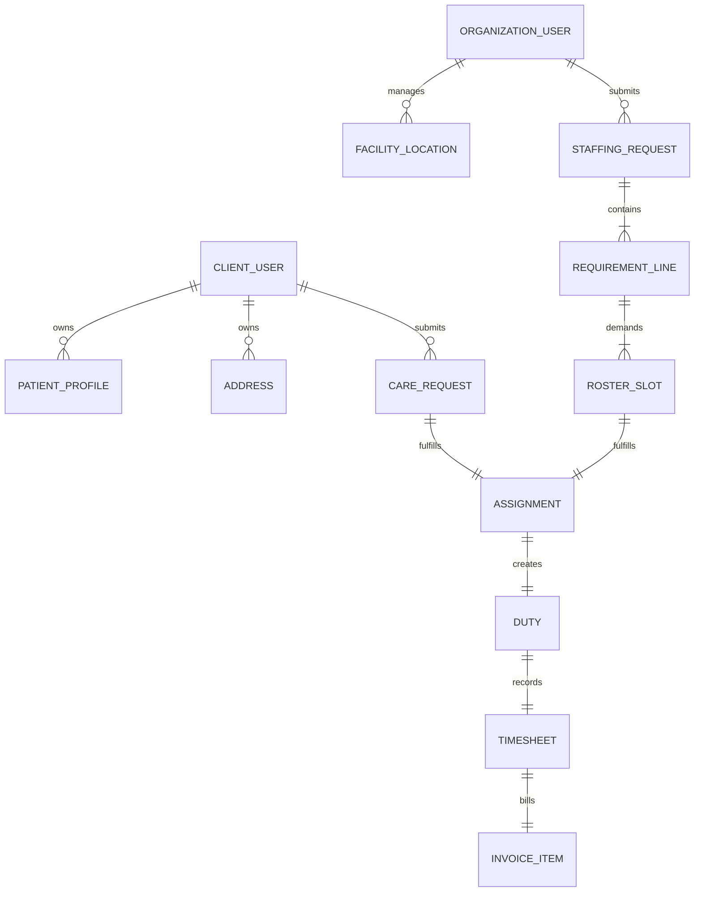
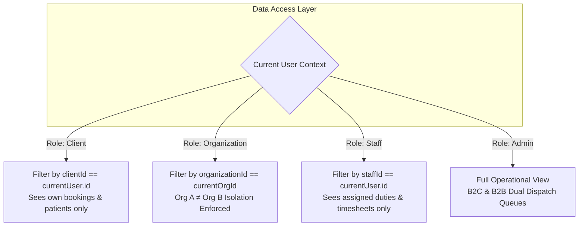

# Pulse n Care — V6.2 Data Architecture, Persistence & Role Isolation Specification

This document specifies the Source of Truth, Repository Data Access Boundaries, Role Isolation Model, Canonical Lifecycle State Machines, and Honest Persistence Realities for the Pulse n Care platform.

---

## 1. Source of Truth Architecture

### Entity Source of Truth Map

| Entity Domain | Primary Type / Symbol | Primary Source of Truth File | Data Layer Owner |
| :--- | :--- | :--- | :--- |
| **Client & Auth** | `User`, `UserRole` | `src/context/AuthContext.tsx` | `AuthContext` state (`currentUser`) |
| **B2C Care Request** | `Booking` | `src/context/BookingContext.tsx` | `BookingContext` state (`bookings` array) |
| **Patient Profile** | `PatientProfile` | `src/types/index.ts` | `MOCK_CLIENTS` & `BookingContext` draft |
| **B2B Staffing Request** | `OrganizationStaffingRequest` | `src/data/mockB2BData.ts` | `MOCK_B2B_REQUESTS` memory array |
| **Requirement Line** | `StaffingRequirementLine` | `src/types/b2b.ts` | `OrganizationStaffingRequest.requirements` |
| **Roster Slot** | `FacilityShiftRosterSlot` | `src/data/mockB2BData.ts` | `MOCK_FACILITY_ROSTER_SLOTS` array |
| **Staff Eligibility** | `StaffProfile`, Conflict Rule | `src/utils/conflictEngine.ts` | `checkStaffConflict()` logic function |
| **Staff Duty** | `Duty`, `DutyStatus` | `src/data/mockStaffData.ts` | `MOCK_DUTIES` & `StaffDutyDetailPage` state |
| **Facility Timesheet** | `FacilityTimesheet` | `src/data/mockB2BData.ts` | `MOCK_FACILITY_TIMESHEETS` array |
| **Institutional Invoice**| `FacilityInvoice` | `src/data/mockB2BData.ts` | `MOCK_FACILITY_INVOICES` array |

---

## 2. Role Scoping & Isolation Architecture

### Access Isolation Rules
1. **B2C Client Scoping**: `MyBookingsPage.tsx` filters `bookings.filter(b => !b.clientId || b.clientId === currentClientId)`. Direct URL parameter tampering to another client's booking is blocked at the data access level.
2. **B2B Organization Scoping**: `OrgRequestsListPage.tsx` and `OrgRosterPage.tsx` filter by `organizationId === 'org-max-saket'`. Organization A can NEVER query or inspect Organization B's staffing requests, roster slots, timesheets, or invoices.
3. **Staff Duty Scoping**: `StaffDashboardPage.tsx` and `StaffDutyDetailPage.tsx` restrict duty views to assigned staff profile (`staff.id === 'EMP-0042'`). Unassigned staff cannot inspect internal client or facility notes.

---

## 3. Canonical Lifecycle State Machines

### B2C Care Request Lifecycle
$$\text{REQUESTED} \longrightarrow \text{UNDER\_REVIEW} \longrightarrow \text{STAFF\_ASSIGNMENT} \longrightarrow \text{CONFIRMED} \longrightarrow \text{IN\_PROGRESS} \longrightarrow \text{COMPLETED}$$

### B2B Staffing Request Lifecycle
$$\text{SUBMITTED} \longrightarrow \text{UNDER\_OPERATIONS\_REVIEW} \longrightarrow \text{PARTIALLY\_ASSIGNED} \longrightarrow \text{FULLY\_ASSIGNED} \longrightarrow \text{IN\_SERVICE} \longrightarrow \text{COMPLETED} \longrightarrow \text{INVOICED}$$

### Staff Duty Transition Matrix
| Current State | Permitted Next States | Blocked Invalid Transitions | Transition Trigger |
| :--- | :--- | :--- | :--- |
| `ASSIGNED` | `ACKNOWLEDGED`, `TRAVELLING` | `COMPLETED`, `IN_CARE` | Staff acknowledges shift assignment |
| `ACKNOWLEDGED` | `TRAVELLING` | `COMPLETED`, `IN_CARE` | Staff begins travel to patient doorstep/facility |
| `TRAVELLING` | `ARRIVED` | `COMPLETED`, `ASSIGNED` | Staff arrives at location |
| `ARRIVED` | `IN_CARE` | `COMPLETED`, `TRAVELLING` | Staff checks in and starts care procedure |
| `IN_CARE` | `COMPLETED` | `TRAVELLING`, `ARRIVED` | Shift complete, daily chart logged & handover signed |
| `COMPLETED` | **NONE (Terminal State)** | **ALL TRANSITIONS BLOCKED** | Shift finalized & submitted to timesheet |

---

## 4. Honest Persistence Reality Classification

| Application Feature | Storage / Persistence Mechanism | Reality Classification | Operational Boundary |
| :--- | :--- | :--- | :--- |
| **B2C Booking Draft** | LocalStorage (`pulsen_care_b2c_booking_draft_v3`) | **Session/Draft Persisted** | Survives browser refresh; cleared upon request submission. |
| **Active Care Bookings** | `BookingContext` Memory State | **Frontend State (Active Session)** | Memory state during active session; resets on hard re-auth. |
| **B2B Staffing Requisitions**| `MOCK_B2B_REQUESTS` Memory Array | **Frontend State (Mock Initialized)** | Unshifts new requests into memory array for current session. |
| **Staff Eligibility Engine** | `checkStaffConflict()` Function | **Real Logic Engine** | Deterministically checks rest windows & schedule overlaps. |
| **Duty Transition Controls** | React State (`StaffDutyDetailPage.tsx`) | **Frontend State** | Validates transition sequence and blocks invalid resets. |
| **Institutional Invoices** | `MOCK_FACILITY_INVOICES` Array | **Mock Data** | Displays mock invoice line items & billing totals. |
| **Payment Gateway** | None (Simulated State) | **NOT IMPLEMENTED** | No live API webhooks or payment processors fabricated. |
| **Live GPS Telemetry** | None (Simulated Indicators) | **NOT IMPLEMENTED** | No hardware IoT/GPS telemetry integrated. |

---

*Document created for V6.2 Persistence & State Hardening.*
