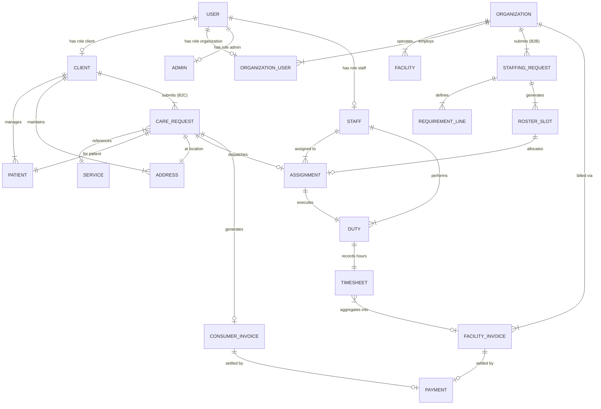

# Pulse n Care — V6.3 Canonical Domain Model

## 1. Domain Entity Hierarchy & Conceptual Model

---

## 2. Master Entity Inventory & Types

### Core Identity & User Entities
* **`User`** (`src/types/index.ts`)
  * `id`: string (UUID / `usr-xxx`) — Master user account ID.
  * `role`: `'client' | 'professional' | 'admin' | 'organization' | 'super_admin' | 'staff'` — Primary authorization role.
  * `email`, `phone`, `firstName`, `lastName`, `avatar`, `isActive`, `isEmailVerified`, `isPhoneVerified`.

* **`ClientProfile`** (`src/types/index.ts`)
  * `id`: string (`clt-xxx`) — B2C consumer account identity.
  * `userId`: string — Pointer to `User.id`.
  * `patients`: `PatientProfile[]` — Associated patients.
  * `addresses`: `Address[]` — Associated delivery locations.

* **`PatientProfile`** (`src/types/index.ts`)
  * `id`: string (`pat-xxx`) — Patient record ID.
  * `clientId`: string — Ownership pointer to `ClientProfile.id`.
  * `firstName`, `lastName`, `relationship`, `dateOfBirth`, `gender`, `medicalNotes`, `mobilityStatus`, `allergies`, `currentMedications`.

* **`Address`** (`src/types/index.ts`)
  * `id`: string (`addr-xxx`) — Location ID.
  * `clientId`: string — Ownership pointer to `ClientProfile.id`.
  * `label`, `line1`, `line2`, `city`, `state`, `pincode`, `latitude`, `longitude`.

---

### B2C Care Request Domain (`Booking`)
* **`Booking`** (`src/types/index.ts`) — *Canonical Type for B2C Care Request*
  * `id`: string (`bkg-xxx`) — Stable primary identifier.
  * `bookingCode`: string (`BKG-YYYY-XXXX`) — Human-readable tracking number.
  * `clientId`: string — Owner client ID (`clt-xxx`).
  * `patientProfile`: `PatientProfile` — Snapshot of target patient.
  * `serviceId`: string — Link to catalog `Service.id`.
  * `address`: `Address` — Execution address snapshot.
  * `scheduledDate`, `scheduledTimeSlot`, `durationHours`, `shiftType`, `dateRange`.
  * `careTasks`: string[] — Requested tasks (medication, vitals, hygiene, etc.).
  * `status`: `BookingStatus` (`DRAFT` | `REQUESTED` | `UNDER_REVIEW` | `ASSIGNED` | `IN_PROGRESS` | `COMPLETED` | `CANCELLED`).
  * `priceBreakdown`: `PriceBreakdown` — Financial breakdown snapshot.

---

### B2B Institutional Staffing Domain (`b2b.ts`)
* **`B2BOrganization`** (`src/types/b2b.ts`)
  * `id`: string (`org-xxx`) — Organization entity ID.
  * `organizationName`: string — e.g. "Max Super Speciality Hospital, Saket".
  * `organizationType`: `B2BOrganizationType` (`hospital` | `clinic` | `rehab_center` | `nursing_home` | `corporate_wellness`).

* **`OrganizationFacilityLocation`** (`src/types/b2b.ts`)
  * `facilityName`: string — e.g. "Saket Main Wing".
  * `department`: string — e.g. "Cardiac ICU Ward 4".
  * `address`, `city`, `pincode`, `contactPersonName`, `contactPersonPhone`.

* **`OrganizationStaffingRequest`** (`src/types/b2b.ts`)
  * `id`: string (`req-b2b-xxx`) — Primary B2B staffing request ID.
  * `requestNumber`: string (`PNC-B2B-YYYY-XXX`) — Institutional tracking code.
  * `organizationId`: string — Owner organization ID (`org-xxx`).
  * `requirements`: `StaffingRequirementLine[]` — Array of requested staffing roles.
  * `totalStaffRequired`: number — Aggregate calculated required headcount.
  * `totalStaffAssigned`: number — Current aggregate fulfilled headcount.
  * `status`: `B2BRequestStatus` (`draft` | `submitted` | `under_review` | `partially_fulfilled` | `fulfilled` | `completed` | `cancelled`).

* **`StaffingRequirementLine`** (`src/types/b2b.ts`)
  * `id`: string (`req-line-xxx`) — Line item ID.
  * `roleCategory`: `'registered_nurse' | 'icu_nurse' | 'physiotherapist' | 'caregiver_attendant' | 'general_physician'`.
  * `requiredCount`: number — Target slot count for this role.
  * `assignedCount`: number — Fulfilled slot count.
  * `shiftType`: `StaffingShiftType` (`12h_day` | `12h_night` | `24h_rotational` | `8h_general`).
  * `agreedDailyRate`: number — Approved contract rate (Configuration Required in production).

* **`FacilityShiftRosterSlot`** (`src/types/b2b.ts`)
  * `id`: string (`rst-xxx`) — Individual slot coverage ID.
  * `requestId`: string — Pointer to parent `OrganizationStaffingRequest.id`.
  * `requirementLineId`: string — Pointer to parent line item.
  * `organizationId`: string — Scoped organization ID.
  * `assignedStaffId`: string | undefined — Assigned in-house employee ID.
  * `status`: `RosterSlotStatus` (`unassigned` | `assigned` | `acknowledged` | `in_progress` | `completed` | `absent` | `replaced`).

---

### Staff & In-House Workforce Domain (`staff.ts`)
* **`StaffAccount` / `StaffProfile`** (`src/types/staff.ts`)
  * `id`: string (`staff-xxx`) — Primary internal staff ID.
  * `employeeId`: string (`PNC-EMP-XXXX`) — Immutable HR employee code.
  * `userId`: string — Associated user login account ID.
  * `roleCategory`: `StaffRoleCategory` — Primary clinical designation.
  * `employmentStatus`: `StaffEmploymentStatus` (`active` | `onboarding` | `on_leave` | `suspended` | `archived`).
  * `qualifications`, `skills`, `assignedServiceAreas`, `availabilitySchedule`.

* **`Duty`** (`src/types/staff.ts` & `mockStaffData.ts`)
  * `id`: string (`duty-xxx`) — Specific shift assignment record.
  * `staffId`: string — In-house staff assigned (`staff-xxx`).
  * `sourceType`: `'b2c_booking' | 'b2b_roster_slot'` — Originating request stream.
  * `sourceId`: string — `bkg-xxx` or `rst-xxx`.
  * `status`: `DutyStatus` (`ASSIGNED` | `EN_ROUTE` | `ON_DUTY` | `COMPLETED` | `CANCELLED`).
  * `clockInTime`, `clockOutTime`, `vitalsRecorded`, `clinicalNotes`.

---

## 3. Mandatory Identity & Ownership Foreign Keys

| Entity | Primary Key | Owner Identity Foreign Key | Parent Container Foreign Key |
| :--- | :--- | :--- | :--- |
| **`ClientProfile`** | `id` (`clt-xxx`) | `userId` (`usr-xxx`) | None |
| **`PatientProfile`** | `id` (`pat-xxx`) | `clientId` (`clt-xxx`) | `ClientProfile` |
| **`Address`** | `id` (`addr-xxx`) | `clientId` (`clt-xxx`) | `ClientProfile` |
| **`Booking` (B2C)** | `id` (`bkg-xxx`) | `clientId` (`clt-xxx`) | None |
| **`OrganizationStaffingRequest`** | `id` (`req-b2b-xxx`) | `organizationId` (`org-xxx`) | `B2BOrganization` |
| **`StaffingRequirementLine`**| `id` (`req-line-xxx`) | `organizationId` (`org-xxx`) | `OrganizationStaffingRequest` |
| **`FacilityShiftRosterSlot`** | `id` (`rst-xxx`) | `organizationId` (`org-xxx`) | `OrganizationStaffingRequest` |
| **`StaffProfile`** | `id` (`staff-xxx`) | `userId` (`usr-xxx`) | `Pulse n Care HR` |
| **`Duty`** | `id` (`duty-xxx`) | `staffId` (`staff-xxx`) | `Booking` / `RosterSlot` |
| **`FacilityTimesheet`** | `id` (`ts-xxx`) | `organizationId` (`org-xxx`) | `FacilityShiftRosterSlot` |
| **`FacilityInvoice`** | `id` (`inv-xxx`) | `organizationId` (`org-xxx`) | `OrganizationStaffingRequest` |
